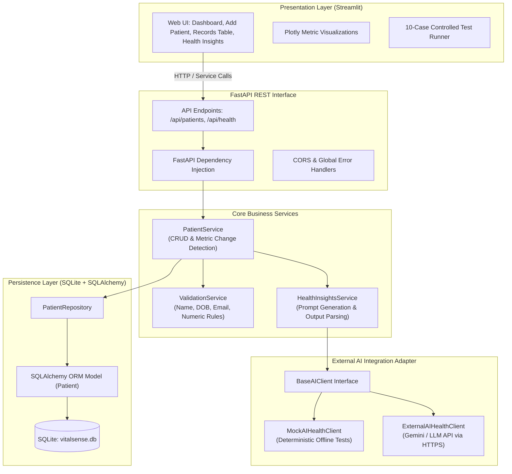

# VitalSense AI — AI-Powered Patient Health Insights & Blood Test Management System

[](https://www.python.org/downloads/)
[](https://fastapi.tiangolo.com)
[](https://streamlit.io)
[](https://www.sqlalchemy.org/)
[](https://docs.pytest.org/)
[](https://opensource.org/licenses/MIT)

VitalSense AI is a full-stack, enterprise-grade healthcare patient management application designed to record, validate, and analyze patient blood test results while generating automated, clinically cautious AI health remarks.

---

## 📑 Table of Contents
- [1. Project Overview & Clinical Mission](#1-project-overview--clinical-mission)
- [2. System Architecture](#2-system-architecture)
- [3. Key Architectural Layers](#3-key-architectural-layers)
- [4. Database Design](#4-database-design)
- [5. Validation Engine & Edge Cases](#5-validation-engine--edge-cases)
- [6. AI Integration & Safety Prompt Design](#6-ai-integration--safety-prompt-design)
- [7. REST API Documentation](#7-rest-api-documentation)
- [8. Frontend Dashboard & Features](#8-frontend-dashboard--features)
- [9. Exact 10-Case Assignment Audit](#9-exact-10-case-assignment-audit)
- [10. Quick Start & Setup Guide](#10-quick-start--setup-guide)
- [11. Automated Testing Suite](#11-automated-testing-suite)
- [12. Technical Interview Talking Points](#12-technical-interview-talking-points)
- [13. Limitations & Roadmap](#13-limitations--roadmap)

---

## 1. Project Overview & Clinical Mission

Modern electronic health record (EHR) systems must balance stringent input validation, resilient external service communication, and strict data privacy. **VitalSense AI** achieves this by:
- Managing patient demographic and blood test metrics (**Glucose**, **Haemoglobin**, **Total Cholesterol**).
- Enforcing domain-level calendar validation (e.g. rejecting impossible leap/month dates like `31.11.2001` and future births).
- Generating non-diagnostic, privacy-preserving AI health remarks without exposing personal identifiable information (PII).
- Persisting patient records reliably in SQLite using SQLAlchemy ORM with full transaction safety.
- Providing an intuitive SaaS interface styled in soft teal (`#0F766E`) and dark navy typography.

---

## 2. System Architecture

VitalSense AI employs a clean, layered architectural pattern isolating routing, validation, domain services, persistence, and external adapters:



---

## 3. Key Architectural Layers

```
vitalsense-ai/
├── app/
│   ├── main.py                     # FastAPI application factory, lifespan, CORS, middleware
│   ├── api/
│   │   ├── dependencies.py         # DB session, Service & Repository dependency injection
│   │   └── routes/
│   │       ├── patients.py         # REST endpoints for Patient CRUD & re-evaluations
│   │       └── health.py           # Health check & system diagnostics endpoint
│   ├── core/
│   │   ├── config.py               # Pydantic BaseSettings (env vars, validation ranges)
│   │   ├── database.py             # SQLAlchemy engine, sessionmaker, Base model
│   │   └── exceptions.py           # Custom domain exceptions & HTTP exception handlers
│   ├── models/
│   │   └── patient.py              # SQLAlchemy Patient ORM entity with timestamps
│   ├── schemas/
│   │   └── patient.py              # Pydantic schemas (Create, Update, Response, Insights)
│   ├── repositories/
│   │   └── patient_repository.py   # Data access layer (CRUD queries, search, pagination)
│   ├── services/
│   │   ├── patient_service.py      # Business logic orchestration & transactional operations
│   │   ├── validation_service.py   # Domain validator (calendar checks, email, numeric checks)
│   │   └── health_insights_service.py # Generates remarks via AI Client Adapter & validates schema
│   ├── integrations/
│   │   └── ai_health_client.py     # Resilient AI Adapter (Gemini/LLM + Mock fallback)
│   └── utils/
│       ├── date_utils.py           # Date parsers (supporting DD.MM.YYYY and DD/MM/YYYY)
│       └── response_utils.py       # Standardized API response formatters
├── frontend/
│   ├── app.py                      # Streamlit entry point (Modern Teal/Navy SaaS UI)
│   ├── components/
│   │   ├── patient_form.py         # Registration & interactive validation
│   │   ├── patient_table.py        # Searchable records table with edit/delete modals
│   │   ├── health_insights.py      # Visual health indicators & non-diagnostic remarks card
│   │   └── batch_import.py         # Controlled 10-record demonstration import runner
│   └── styles/
│       └── custom.css              # Custom styling (soft teal, dark navy, card shadows)
├── tests/
│   ├── conftest.py                 # Test fixtures, SQLite in-memory DB, mocked AI client
│   ├── test_patients.py            # API CRUD & status code tests
│   ├── test_validation.py          # Strict date, email, numeric edge case tests
│   ├── test_health_insights.py     # Prompt formatting, disclaimer & structured schema tests
│   ├── test_ai_integration.py      # Timeout, rate limit, invalid key, fallback tests
│   └── test_persistence.py         # Data persistence & restart verification
├── scripts/
│   └── seed_data.py                # Standalone script to run the exact 10 test cases
├── .env.example
├── .gitignore
├── requirements.txt
├── README.md
└── run.py                          # Launcher script for API, UI, tests, or seed import
```

---

## 4. Database Design

VitalSense AI utilizes SQLAlchemy ORM backed by SQLite for robust, zero-dependency persistence.

### Entity: `Patient` (`patients` table)
| Column | Type | Constraints | Description |
|---|---|---|---|
| `id` | `INTEGER` | Primary Key, Auto-increment | Unique identifier |
| `full_name` | `VARCHAR(255)` | NOT NULL | Patient legal name |
| `date_of_birth` | `DATE` | NOT NULL | Normalized calendar birth date |
| `email` | `VARCHAR(255)` | NOT NULL, Indexed | Contact email (**No UNIQUE constraint**, supporting valid repeat entries like Test 6) |
| `glucose` | `FLOAT` | NOT NULL | Fasting blood glucose (mg/dL) |
| `haemoglobin` | `FLOAT` | NOT NULL | Blood haemoglobin level (g/dL) |
| `cholesterol` | `FLOAT` | NOT NULL | Total serum cholesterol (mg/dL) |
| `remarks` | `TEXT` | Nullable | Human-readable AI health summary |
| `ai_insights_json` | `TEXT` | Nullable | Raw structured AI insights JSON payload |
| `created_at` | `DATETIME` | NOT NULL, Default UTC | Initial registration timestamp |
| `updated_at` | `DATETIME` | NOT NULL, Default UTC | Last modification timestamp |

---

## 5. Validation Engine & Edge Cases

The domain validator (`app/services/validation_service.py`) implements strict, multi-error accumulation:

1. **Full Name**:
   - Required, trimmed of leading/trailing whitespace.
   - Rejects names consisting exclusively of digits (e.g. `"12345"`).
   - Supports alphabetic characters, hyphens, periods, spaces, and Roman numerals (e.g. `"Madison XI"`).
2. **Date of Birth**:
   - Accepts both `DD.MM.YYYY` (test data notation) and `DD/MM/YYYY` (manual entry notation).
   - Validates physical calendar feasibility via Python `datetime.strptime`. Specifically rejects impossible dates (e.g. `31.11.2001`, as November has only 30 days).
   - Verifies the date is not in the future (e.g. `19.10.2030`).
   - Normalizes internally to a `datetime.date` object and formats responses as `DD/MM/YYYY`.
3. **Email**:
   - Validates RFC-compliant email structure using regular expressions checking local username, `@`, domain name, and valid TLD with at least 2 characters.
   - Rejects malformed patterns such as `hunter@gmail` (missing domain extension) and `Kris.wu.gmail.com` (missing `@`).
   - Does not silently modify or fabricate invalid emails.
4. **Numeric Measurements (Glucose, Haemoglobin, Cholesterol)**:
   - Enforces numeric type; rejects non-numeric strings, `NaN`, and `Infinity`.
   - Configurable limits via `settings`:
     - Glucose: `10.0 - 1000.0 mg/dL`
     - Haemoglobin: `1.0 - 35.0 g/dL`
     - Total Cholesterol: `20.0 - 1500.0 mg/dL`
   - **Clinical Safety vs Validation Principle**: Low or abnormal values (e.g. Madison XI with `7.6 g/dL` Hb) are numerically valid and accepted by the database; clinical concern is surfaced exclusively through cautious remarks, not input rejection.
5. **Multiple Error Accumulation**:
   - When a record violates multiple rules (e.g. Kris Wu has an invalid future DOB and a missing `@` in email), both errors are captured and returned simultaneously in the response payload.

---

## 6. AI Integration & Safety Prompt Design

### Privacy Preservation (PII Anonymization)
In accordance with Section 12, **patient names and email addresses are never transmitted to the external AI model**. Only anonymized numerical measurements (`glucose`, `haemoglobin`, `cholesterol`) and approximate age in years are passed to the model prompt.

### Prompt Template
```
You are an expert clinical laboratory data interpreter assisting healthcare providers.
Analyze the following objective blood test measurements:
- Glucose: {glucose} mg/dL
- Haemoglobin: {haemoglobin} g/dL
- Total Cholesterol: {cholesterol} mg/dL
- Approximate Age: {age_str}

CRITICAL MEDICAL AND SAFETY GUIDELINES:
1. Explain possible health concerns associated with these values.
2. Identify values that warrant further evaluation or physician review.
3. Explicitly state that interpretation depends on laboratory-specific reference ranges, age, sex, and clinical history.
4. DO NOT claim to diagnose a disease.
5. DO NOT prescribe medication or issue specific treatment instructions.
6. Conservative guidance: Recommend consulting a qualified healthcare professional.
7. Return your response STRICTLY as a valid JSON object matching the required schema.
```

### Structured Output Schema
```json
{
  "summary": "Brief health insight summary",
  "observations": [
    "Observation about glucose",
    "Observation about haemoglobin",
    "Observation about cholesterol"
  ],
  "recommendation": "General next-step guidance",
  "disclaimer": "This is an automated educational insight and is not a medical diagnosis."
}
```

### Failure Resilience
- **Deterministic Mock Provider**: Used for automated testing and offline evaluation without paid API keys.
- **Graceful Degradation**: If the external API times out or returns HTTP 429/500, the patient record is safely saved with a `"AI Remarks Pending [Retry Available]"` note. Patient registration is never aborted due to an upstream AI failure.

---

## 7. REST API Documentation

| Method | Endpoint | Description | Status Codes |
|---|---|---|---|
| `GET` | `/api/health` | System health check & database diagnostic | `200` |
| `GET` | `/api/patients` | Retrieve all patients (supports `?search=` and pagination) | `200` |
| `GET` | `/api/patients/{id}` | Fetch individual patient by primary key | `200`, `404` |
| `POST` | `/api/patients` | Register new patient, validate data, and generate remarks | `201`, `422` |
| `PUT` | `/api/patients/{id}` | Update patient; regenerates AI remarks if metrics change | `200`, `404`, `422` |
| `DELETE` | `/api/patients/{id}` | Delete patient record permanently | `200`, `404` |
| `POST` | `/api/patients/{id}/generate-insights` | Force re-evaluation of AI remarks | `200`, `404` |
| `POST` | `/api/patients/batch-import` | Controlled 10-case evaluation endpoint | `200` |
| `GET` | `/api/patients/metrics/dashboard` | Dashboard KPI counts | `200` |

---

## 8. Frontend Dashboard & Features

Built using **Streamlit** with customized CSS styling:
1. **Clinical Dashboard**:
   - Total patient metrics cards.
   - Live system telemetry indicator (`🟢 FastAPI Backend: ONLINE` / `🔷 Direct Service Mode`).
   - Recent patient records feed.
2. **Patient Registration Form**:
   - Grouped demographic and blood test input fields.
   - Instant field-level error messages.
   - Real-time AI remark preview upon successful submission.
3. **Patient Management Records Table**:
   - Real-time search by patient name or email.
   - Quick action buttons: View Insights (`👁️`), Edit (`✏️`), Regenerate AI (`✨`), Delete (`🗑️`).
   - Step 5 Demo: Direct email editing to `gokul@infocare.com`.
   - Step 6 Demo: Interactive deletion confirmation.
4. **Health Insights View**:
   - Patient selector dropdown.
   - Visual Plotly gauges comparing patient metrics to standard adult physiological reference bands:
     - Glucose: Normal fasting `70 - 140 mg/dL`
     - Haemoglobin: Normal adult `12.0 - 17.5 g/dL`
     - Total Cholesterol: Desirable `< 200 mg/dL`
   - High-visibility medical disclaimer card.
5. **Controlled 10-Case Assignment Runner**:
   - 1-click execution of the exact test cases with visual audit cards.

---

## 9. Exact 10-Case Assignment Audit

The application was verified against all 10 evaluation test cases:

| Test # | Patient Name | Submitted DOB | Submitted Email | Glucose | Hb | Chol | Outcome | Assignment Audit Note |
|---|---|---|---|---|---|---|---|---|
| **1** | Robyn Pears | `28.01.1960` | `robyn@gmail.com` | 232.0 | 13.5 | 180.0 | **ACCEPTED** | Valid format; hyper-glycaemia noted in remarks. |
| **2** | John Hunter | `10.12.1990` | `hunter@gmail` | 94.0 | 15.0 | 200.0 | **REJECTED** | Malformed email address (missing domain extension). |
| **3** | Darryl Tim | `12.11.1993` | `timd@smh.com.au` | 240.0 | 18.6 | 326.0 | **ACCEPTED** | Australian TLD validated successfully. |
| **4** | Peter Larry | `31.11.2001` | `Larry@hotmail.com` | 88.0 | 11.5 | 165.0 | **REJECTED** | Impossible calendar date (November has only 30 days). |
| **5** | Sam Kerr | `09.12.2006` | `sam@news.com.au` | 198.0 | 8.9 | 192.0 | **ACCEPTED** | Valid format; low Hb noted in remarks. |
| **6** | Robyn Pears | `28.01.1960` | `robyn@gmail.com` | 232.0 | 13.5 | 180.0 | **ACCEPTED** | Duplicate record accepted separately without overwrite. |
| **7** | Madison XI | `12.09.1998` | `madison@hotmail.com` | 85.0 | 7.6 | 163.0 | **ACCEPTED** | Low Hb (`7.6`) is numerically valid; accepted without rejection. |
| **8** | Kris Wu | `19.10.2030` | `Kris.wu.gmail.com` | 79.0 | 16.5 | 197.0 | **REJECTED** | **Both errors displayed together**: Future DOB and missing `@`. |
| **9** | Tenille Singh | `30.11.1991` | `Tenille@yahoo.com` | 101.0 | 15.0 | 310.0 | **ACCEPTED** | Valid record accepted. |
| **10** | Prem Kumar | `28.04.1990` | `prem@telstra.com` | 155.0 | 12.5 | 265.0 | **ACCEPTED** | Valid record accepted. |

### Summary Verification
- **Total Submitted**: 10
- **Valid Accepted**: 7
- **Invalid Rejected**: 3
- **Accepted Duplicate Entries**: 1 (Test 6)
- **Invalid Email Records**: 2 (Test 2: `hunter@gmail`, Test 8: `Kris.wu.gmail.com`)
- **Invalid Date Records**: 2 (Test 4: `31.11.2001`, Test 8: `19.10.2030`)

---

## 10. Quick Start & Setup Guide

### Prerequisites
- Python 3.9, 3.10, 3.11, or 3.12+
- Git

### Installation
1. **Clone the Repository**:
   ```bash
   git clone https://github.com/your-username/vitalsense-ai.git
   cd vitalsense-ai
   ```

2. **Create and Activate a Virtual Environment**:
   ```bash
   # Windows
   python -m venv venv
   .\venv\Scripts\activate

   # Linux / macOS
   python3 -m venv venv
   source venv/bin/activate
   ```

3. **Install Dependencies**:
   ```bash
   pip install -r requirements.txt
   ```

4. **Configure Environment Variables**:
   ```bash
   cp .env.example .env
   ```
   *(By default, `AI_PROVIDER=mock` enables instant offline evaluation without paid API keys).*

### Running the Application

You can launch components using the unified `run.py` CLI:

- **Launch Streamlit Frontend (Recommended for Interview Demo)**:
  ```bash
  python run.py frontend
  ```
  *Opens automatically at `http://localhost:8501`.*

- **Launch FastAPI REST Backend**:
  ```bash
  python run.py api
  ```
  *API available at `http://localhost:8000`. Interactive Swagger docs at `http://localhost:8000/docs`.*

- **Run Both Simultaneously**:
  ```bash
  python run.py all
  ```

- **Run Standalone 10-Case Demonstration Script**:
  ```bash
  python run.py seed
  ```

---

## 11. Automated Testing Suite

The project includes 24 automated unit, integration, and persistence tests:

```bash
python -m pytest tests/ -v
```

### Test Coverage Highlights:
- **`tests/test_validation.py`**: Validates names, calendar date parsing (`DD.MM.YYYY` and `DD/MM/YYYY`), future date rejection, email regex, numeric boundaries, and accumulated multi-error reporting (Kris Wu).
- **`tests/test_patients.py`**: Validates complete CRUD REST operations, 404 responses for missing IDs, email updating to `gokul@infocare.com`, automatic AI re-evaluation upon metric change, duplicate record acceptance, and the exact 10-case batch import summary.
- **`tests/test_health_insights.py`**: Ensures patient names and emails are never present in model prompts and verifies structured JSON response parsing.
- **`tests/test_ai_integration.py`**: Simulates HTTP 401 invalid keys, HTTP 429 rate limits, request timeouts, malformed JSON, and ensures patient data is never lost when AI is unavailable.
- **`tests/test_persistence.py`**: Validates database persistence across application restarts and connection lifecycle disposal.

---

## 12. Technical Interview Talking Points

During technical evaluation, you can explain:

1. **How FastAPI handles requests**:
   - Uses dependency injection (`Depends`) in `api/dependencies.py` to provide scoped database sessions and service instances per request.
   - Pydantic models automatically validate incoming request bodies and generate interactive OpenAPI documentation at `/docs`.
2. **How Pydantic validates data**:
   - `PatientBase`, `PatientCreate`, `PatientUpdate`, and `AIInsightsSchema` define schema contracts. Custom validators in `ValidationService` catch domain anomalies before any database write occurs.
3. **How SQLAlchemy interacts with SQLite**:
   - Connects through a managed engine with `check_same_thread=False` for thread safety.
   - Declarative base maps the `Patient` entity, handling timestamps and queries via parameterized ORM methods that prevent SQL injection.
4. **Service & Repository Layer Separation**:
   - `PatientRepository` handles purely SQL queries and database persistence.
   - `PatientService` manages business logic, metric change detection, and coordinates between validation and AI generation.
5. **How the AI API is called safely**:
   - The adapter pattern (`BaseAIClient`, `MockAIHealthClient`, `ExternalAIHealthClient`) isolates external HTTP calls.
   - Patient PII is completely stripped before prompt construction.
   - Timeouts and exceptions are caught to protect patient records from data loss.

---

## 13. Limitations & Roadmap

- **Current Limitations**: SQLite does not support native concurrent writes in multi-process distributed environments.
- **Future Improvements**:
  - PostgreSQL support with Alembic database migrations.
  - Multi-tenant role-based access control (Doctor, Nurse, Lab Technician).
  - Integration with FHIR / HL7 international healthcare standards.
  - Longitudinal trend charts across multiple blood tests over time.

---

## 👨‍💻 License
Distributed under the MIT License. Built for rigorous technical skills assessment.
